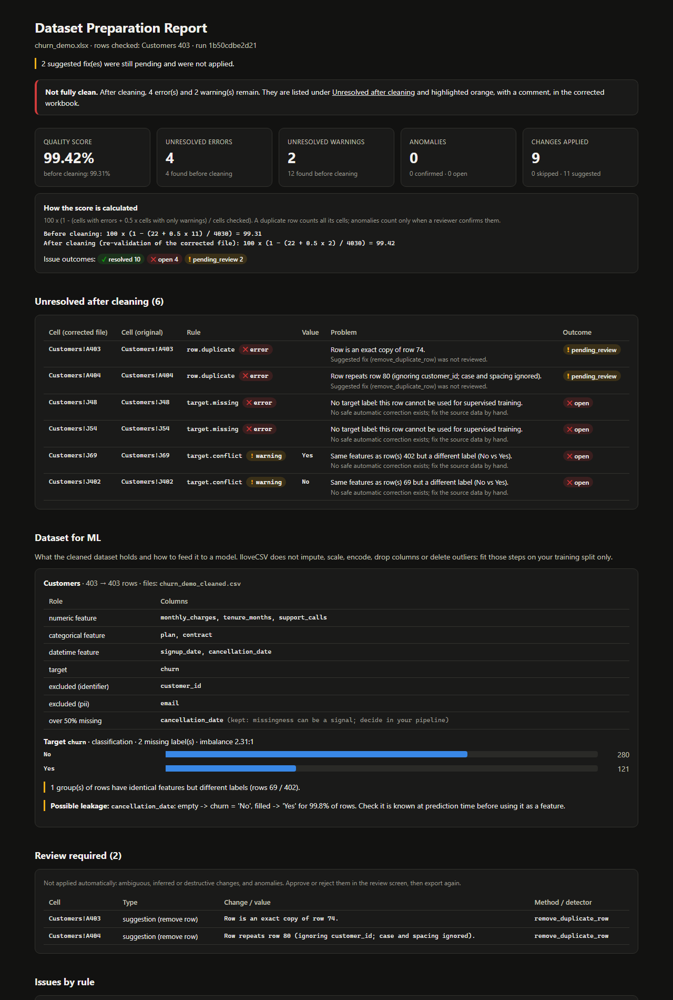

# IloveCSV: Universal Dataset Inspection and Safe Preparation for Machine Learning

One command takes a raw dataset (CSV, Excel, JSON, Parquet, a ZIP of files, a MATLAB `.mat`, NumPy or HDF5) and returns a **cleaned dataset** plus a **machine-readable cleaning report**, ready for your own feature-engineering and training code. It replaces inspecting every new dataset and rewriting the same basic cleaning code.

```bash
ilovecsv inspect B0005.mat                 # structure first: tables, rows, columns, samples, docs
ilovecsv prepare customers.xlsx --target churn
```

## Supported formats

Every format is read by an **adapter** that turns it into clearly defined tables. One shared quality engine then profiles, validates, safely cleans and re-validates them, whatever they came from.

| Tier | Formats | How they become tables |
|---|---|---|
| 1 | `.csv` `.tsv` `.txt` | Delimiter and encoding detected (or `--delimiter`, `--encoding`); streamed when sampling |
| 1 | `.xlsx` `.xlsm` `.xls` | One table per sheet (`--sheet`). Macros are never run; `.xls` needs `xlrd` |
| 1 | `.json` `.jsonl` `.ndjson` | Records found automatically or by dot path (`--json-records data.items`); nested objects flattened to `customer.city`; lists kept as JSON text |
| 1 | `.parquet` `.feather` `.arrow` | Read from metadata first; row-group sampling for large files |
| 1 | `.zip` | Every supported member becomes a table; same-named tables with identical columns are merged with a `source_file` column. README / data-dictionary members are read as **documentation** (e.g. "missing values are coded as -999"). Unsafe paths, too many members and zip bombs are refused |
| 2 | `.mat` (v4–v7.2 via SciPy, v7.3 via h5py) | Known layouts (NASA battery aging: `cycles`, `measurements`, `impedance`) or generic rules: 2-D arrays, equal-length fields of one struct, struct arrays (one row per element, plus a long-format `…series` table for per-element series, keyed by element index; series of different lengths are reported). Text fields such as the cycle type are repeated on each series row. Numeric per-element fields are repeated only when named (`--series-context ambient_temperature`), because one may be the outcome (capacity) |
| 2 | `.npy` `.npz` | 1-D and 2-D arrays, each array its own table (or one table with `--align-arrays`). A text array that only lists the other arrays' names is kept as metadata. Pickled objects are never loaded |
| 2 | `.h5` `.hdf5` | Every 1-D/2-D dataset becomes a table; groups, shapes, dtypes and attributes are listed by `inspect` and kept in the manifest |
| 2 | `.arff` | Via SciPy; `?` is missing |

**Arrays are not assumed to be aligned.** Same-length 1-D arrays (NumPy, an HDF5 group, MATLAB variables) may be the columns of one table, but equal length alone does not prove it. `inspect` points them out, and they are combined only when you say so (`--align-arrays`, or the checkbox in the UI).

**Nothing is guessed.** A structure with no single obvious table form (a 3-D array, a cell array of mixed content, variable-length struct fields) is listed under `unsupported` with the reason, and nothing about it is invented. Optional extras: `pip install ilovecsv[all-formats]` (or `parquet`, `scientific`, `legacy-excel`).

**Large files.** `inspect` reads structure only (metadata, line counts, a 1,000-row sample) and estimates memory use. Above `row_limit` (default 1,000,000 rows per table) a full prepare is refused unless you choose a sample (`--max-rows N`). The output of a sampled run is then labelled **PARTIAL** everywhere.

It handles the generic data-quality stage only. Changes are **reproducible and auditable**: every change, removal and remaining problem is recorded with its reason. Anything task-dependent stays in your ML pipeline.

Built with Python, pandas, openpyxl, scikit-learn, SQLAlchemy (SQLite), FastAPI and Streamlit.



## One-click prepare

| Step | What happens |
|---|---|
| Profile | Detects numeric, categorical, datetime, boolean, text, id and contact (PII) columns, missingness, and placeholder values |
| Validate | Draft rules from the profile (or your saved config): types, ranges from the non-outlier bulk, formats, keys, duplicates |
| **Safe Auto-Clean** | Applies only lossless or pure-formatting fixes: trimming, case variants, `N/A`/`-`/`null` → empty cells, email/phone formats, unambiguous number and date conversions, declared aliases |
| **Review Required** | Queues everything ambiguous, inferred or destructive: fuzzy matches, inferred or ambiguous dates, formula fixes, duplicate-row removal, anomalies |
| Re-validate | Re-checks the cleaned output and reports what is still wrong, and why |
| Export | The cleaned dataset, a JSON + Excel + HTML report, a reproducible config, and an untouched copy of the input |

One click never means "one click followed by silent corruption". Nothing is deleted, imputed or guessed without a person. Exact duplicates are removed automatically only if you turn that on (`--remove-exact-duplicates`); near-duplicates always go to review.

### Where IloveCSV stops

It **does not** impute missing values, scale, encode, drop columns, or delete outliers. Those choices depend on the ML task:
* mean imputation is wrong for skewed data;
* an "outlier" may be the fraud case you want to learn;
* a mostly-empty column may still be a strong predictor.

Steps whose parameters are learned from data (imputation, scaling, encoding) must be **fitted on the training split only** and then applied to validation and test data. Fitting them on the full dataset leaks information. IloveCSV hands over a clean, typed, documented table for exactly that pipeline.

### ML-specific checks (flag only)

With `--target <column>`:
* **Missing labels:** rows without a label are flagged as unusable for supervised training; they are kept, not dropped. A `?` label counts as missing, not as a class.
* **Valid labels:** `--labels No,Yes` (or inferred from the data). Variants such as ` yes ` or `NO` become exactly `Yes` and `No`; any other value (e.g. `Maybe`) is flagged as an unrecognised label and never guessed.
* **Label conflicts:** rows identical on every feature but with different labels.
* **Class balance**, or a distribution summary for a numeric target.
* **Possible leakage:** a column, or its missingness, that alone predicts ≥ 95% of labels and removes ≥ 80% of the errors of always guessing the majority class. One stray row cannot hide a leak, and an imbalanced target cannot fake one. Example: `cancellation_date` exists only for churned customers.
* **Label protection:** the target is excluded from anomaly detection (a rare class is the signal). Its labels get only case and spacing fixes automatically; aliases on the target need review.

The report always includes a **feature schema**: each column's role and pandas dtype, plus feature lists for a scikit-learn `ColumnTransformer`. IDs and PII are listed as excluded from features.

The feature lists contain only columns that are **ready**. A column moves to `needs_review`, with the reason, when:
* it is a leakage suspect;
* some of its values could not be parsed (for example `"two"` in a count column), so it was exported as text.

It stays in the dataset; you decide.

**Placeholders.**
* `N/A`, `-`, `null`, `?` and similar become empty cells in every column.
* Words such as `unknown`, `missing` or `not available` are **field-aware**. They become empty in numeric, date and boolean columns, where a real value can't be a word. In a category column, they become empty only when they are not a declared category: a one-off `unknown` among city names is cleared, while a real `Unknown` status that is one of the column's established values stays.
* A whole number written with decimals (`999.00`) in a whole-number column becomes `999` in every format, so CSV, Excel and JSON input give the same dataset (and the column stays an integer column).
* A value outside a category list is flagged, never replaced. A close spelling (`Hydrabad`) gets a fix suggestion for review; a likely alias (`bangalore`) gets a hint naming the closest allowed value (`Bengaluru`), applied only if you declare it under `aliases`.
* Both lists are configurable (`null_values`, `typed_null_values`).
* Missing values are reported, never imputed.

**Numeric bounds.** A column that is almost never negative (≤ 5% of values) gets `min: 0`, so a stray `-4` age is an error even in a small file.

### Outputs (`prepared/`)

| File | Contents |
|---|---|
| `{name}_cleaned.csv` | The **ML-ready dataset**: ISO-8601 dates, plain numbers, empty cells for missing values (one file per data sheet). For CSV input this is also the cleaned file |
| `{name}_cleaned.parquet` | Optional (`--format parquet`): typed columns (`Int64`, `Float64`, `datetime64`, `category`) |
| `{name}_cleaned.xlsx` | Excel input: the **cleaned workbook**, same sheets and formatting as the upload, with changed cells (yellow) and unresolved cells (orange) marked and commented |
| `{name}_cleaning_report.json` | Machine-readable: `schema_version`, config, dataset rows before/after, feature schema, ML checks, every change and removed row (with original and cleaned row numbers), the review queue, unresolved issues |
| `{name}_cleaning_report.xlsx` / `.html` | Human-readable audit: summary, unresolved, review required, dataset for ML, changes, removed rows |
| `{name}_prepare_config.yaml` | The **recipe**: source options (sheets, tables, JSON path, sample), rules, policy, roles and your review decisions, to prepare new batches the same way |
| `{name}_manifest.json` | Handoff manifest: source format and hash, how each table was formed (conversion notes), rows read and exported, file hashes, documentation found, unsupported parts, split hints (group / time columns), the transformations deliberately *not* done, and the verification result |
| `{name}_feature_schema.json` | Column roles and dtypes per table, for your pipeline |
| `prepare_dataset.py` | A script that re-runs this exact preparation (`python prepare_dataset.py new_file.mat`) |
| `{name}_cleaned_tables.zip` | Non-spreadsheet sources: every corrected table as CSV |
| `original/{file}` | Untouched copy of the input (its SHA-256 is in the report) |

**Reports you can check.** The Excel and HTML reports open with **Findings**, grouped by category: structure, missing values, invalid values, suspicious readings, duplicates, labels, conversions applied and the review queue, each with cell references and values. **Source & structure** shows how every table was formed, the file's internal structure (groups, shapes, attributes), parts not converted, and documentation hints. `python scripts/check_testpack.py PATH` checks all 84 expectations of the SheetSense preprocessing test pack against the reports.

**Post-export verification.** After writing, IloveCSV reopens every dataset it exported. It checks columns and row counts against the run, confirms each applied fix is present, and re-validates the files themselves. The result is in the report and the manifest; the CLI prints it.

A column whose values can't all be parsed (e.g. `"about a year"` in a numeric column) stays text in the typed outputs. The report says so; nothing is silently set to NaN.

### Use the result in your pipeline

```python
from ilovecsv.ml import load_prepared
from sklearn.compose import ColumnTransformer
from sklearn.impute import SimpleImputer
from sklearn.model_selection import train_test_split
from sklearn.pipeline import make_pipeline
from sklearn.preprocessing import OneHotEncoder, StandardScaler

df, schema = load_prepared("prepared/customers_cleaning_report.json")  # cleaned CSV with recorded dtypes
df = df.dropna(subset=[schema["excluded"]["target"]])                  # your decision, made explicitly
num, cat = schema["features"]["numeric"], schema["features"]["categorical"]
X_train, X_test, y_train, y_test = train_test_split(df[num + cat], df[schema["excluded"]["target"]],
                                                    stratify=df[schema["excluded"]["target"]], random_state=0)
prep = ColumnTransformer([
    ("num", make_pipeline(SimpleImputer(strategy="median"), StandardScaler()), num),
    ("cat", make_pipeline(SimpleImputer(strategy="most_frequent"), OneHotEncoder(handle_unknown="ignore")), cat),
])
prep.fit(X_train)  # learned on the training split only
```

### Reproducible on new data

```bash
ilovecsv prepare train.csv --target churn --out prepared/
ilovecsv prepare next_month.csv --config prepared/train_prepare_config.yaml --out prepared_next/
```

The second run reuses the same rules instead of re-suggesting them from the new data, so training data and later scoring data are cleaned identically. Review decisions recorded in the recipe (approved or rejected fixes, dismissed anomalies) are re-applied where they still match, and the report counts how many did.

Recipes are plain YAML you can write by hand. [`examples/recipes/nasa_battery.yaml`](examples/recipes/nasa_battery.yaml) holds domain bounds for the NASA battery aging files (capacity 0–2.5 Ah, temperature, resistances), with `battery` as the group and `start_time` as the time column for splitting. It prepares B0005, B0006 and B0018 with 0 errors and passing verification.

### Entry points

* **CLI:** `ilovecsv inspect FILE [--json]`, and `ilovecsv prepare FILE [--target COL] [--labels No,Yes] [--out DIR] [--config CFG] [--remove-exact-duplicates] [--format csv --format parquet]`. Source options: `--sheet`, `--table`, `--json-records`, `--max-rows`, `--delimiter`, `--encoding`, `--mat-layout`, `--align-arrays`, `--series-context`. Exits with code 1 while unresolved errors remain, so it can gate a data pipeline in CI.
* **Python:** `from ilovecsv.pipeline import prepare; res = prepare("data.csv", target="churn")`, then `res.dataset_path()`, `res.report` and `res.unresolved`.
* **API:** `POST /v1/workbooks` (any supported format), `GET /v1/workbooks/{id}/inspect`, `POST /v1/workbooks/{id}/prepare` (with optional `source` options), then `GET /v1/runs/{id}/dataset`, `/report`, `/config` and `/handoff/{manifest|feature_schema|script}`.
* **UI:** the first page, **★ One-click prepare**: upload, inspect (tables, sample rows, documentation, unsupported parts), choose tables or a sample, pick the target (auto-guessed), Prepare, then download. The numbered pages are the advanced review flow for working through the review queue.

On the demo churn table (`python scripts/make_demo.py`: 403 rows, planted problems), one click:
* applies 9 safe fixes: 4 placeholders emptied, 3 label case variants, 2 currency strings converted to numbers;
* queues the exact and near-duplicate rows for review;
* flags 2 missing labels, 1 label conflict and the `cancellation_date` leak;
* keeps all 403 rows and every column.

## What else it does

| Capability | How |
|---|---|
| **Rule-based validation** | A YAML rule file covers required fields, types, numeric and date ranges, not-in-future dates, allowed categories, **known aliases** (`Bangalore → Bengaluru`), **email and phone formats**, regex, length, uniqueness and composite keys. It also supports **cross-column checks** (`ship_date >= order_date`), **conditional requirements** (`when status == 'Shipped'` require `ship_date`) and **lookups** against another sheet. Built-in checks flag **duplicate records** (ignoring a surrogate id such as `C001, C002…`), extra spaces, placeholder nulls, and values capitalised differently elsewhere in the column. |
| **Data profiling** | Per column: inferred type and how much of the column fits it, missing rate (with configurable null tokens), distinct count, top values, quantiles, histogram, date range, text shape patterns, extra spaces, case variants, numbers and dates stored as text, Excel serial dates, email and phone columns, surrogate ids, and **placeholder values** (e.g. one date used in 4% of rows). Documentation sheets such as `Readme` are recognised and skipped. |
| **Anomaly detection** | Robust z-score (median/MAD) per numeric column, an IQR fallback, rare categories, and a row-level **Isolation Forest** after PCA whitening, which catches combinations that are each normal on their own. Anomalies are **kept separate from errors**: never auto-fixed, never deleted; a reviewer confirms or dismisses each one. |
| **Review workflow** | Each issue's outcome is decided by re-validating the cleaned output: resolved, open, pending_review, approved, rejected or dismissed. Duplicate pairs are shown side by side before removal. Unresolved cells are marked in the cleaned workbook. |
| **API engineering** | FastAPI with API-key auth (keys stored as SHA-256 hashes), per-user isolation, a streaming body-size limit, extension and magic-byte checks, zip-bomb and macro rejection, RFC 9457 `application/problem+json` errors, and a SQL-backed audit log. |
| **Testing** | 175 tests, including every format adapter and the ZIP safety limits. Seeded synthetic datasets carry **known planted problems and a ground-truth manifest**. Tests check that each rule catches *exactly* the cells it should, across several seeds; that a clean file produces zero issues; that Safe Auto-Clean changes only safe things; and the report contract. |

## Architecture

```
Streamlit UI ──httpx──► FastAPI (/v1) ──► core engine (pure Python, no web dependencies)
                            │             reader → profiler → rules → anomalies → corrections
                            │             → resolution → dataset + ml → report
                            └──► SQLite: users, workbooks, runs, issues, suggestions, audit_events
```

* The **core engine** (`src/ilovecsv/`) is used directly by the CLI, `prepare()` and the tests.
* The **API** stores issues and decisions in SQLite. Validation is deterministic, with ids derived from the sheet, row, column and rule. Export therefore re-runs the pipeline and overlays the stored decisions, and the database never has to hold dataset contents.
* The **UI** talks only to the API.

| Module | Role |
|---|---|
| `reader.py` | openpyxl/CSV loading. Finds the header row (skipping title rows), spreads merged header cells, keeps row numbers and column letters, marks formula cells, keeps raw values (so `00123` stays text). |
| `profiling.py` | Column and sheet profiles. |
| `rules/schema.py`, `rules/suggest.py` | Pydantic models for the YAML; draft rules from a profile; the prepare options (target, duplicate policy). |
| `rules/expr.py` | **Safe expression evaluator.** It parses with `ast` against a whitelist and evaluates vectorised over pandas. `eval` and `DataFrame.eval` are never called. |
| `rules/engine.py` | Turns rules and built-in checks (including target checks) into `Issue`s with cell references. |
| `anomalies.py` | Statistical detectors and Isolation Forest. |
| `corrections.py` | Suggests fixes, classifies each as **safe** or **review**, and writes only approved ones. |
| `resolution.py` | Decides each issue's outcome from re-validation, mapping deleted rows back to original row numbers. |
| `ml.py`, `dataset.py` | Feature schema, target summary, leakage suspects, typed frames, `load_prepared`; cleaned CSV/Parquet writers. |
| `pipeline.py` | `run_checks`, `decide`, `export` and `prepare`. |
| `report.py`, `explain.py` | Cleaning report (JSON contract, Excel, HTML) and plain-English explanations. |
| `api/` | FastAPI app, auth, uploads, problem+json errors, routes. |
| `synth.py` | Synthetic datasets (churn, orders, edge cases) with ground truth. |

## Quick start

```bash
python -m venv .venv && .venv\Scripts\activate        # Windows (source .venv/bin/activate elsewhere)
pip install -e ".[ui,dev,parquet]"

python scripts/make_demo.py      # builds examples/churn_demo.xlsx + the orders demo, writes reports/
ilovecsv prepare examples/churn_demo.xlsx --target churn --out prepared/
pytest                           # 175 tests
```

### CLI: rule-file workflow

For data-quality audits with your own rules (no auto-approval):

```bash
ilovecsv profile examples/demo_orders.xlsx
ilovecsv suggest-rules examples/demo_orders.xlsx > my_rules.yaml
ilovecsv check examples/demo_orders.xlsx --rules examples/rules_orders.yaml --out reports/out
ilovecsv check examples/demo_orders.xlsx --rules examples/rules_orders.yaml --out reports/out --approve-min 0.9
```
`check` exits with code 1 when errors remain, so it can gate a data pipeline in CI.

### API + UI

Run each command in its **own terminal**, from the project folder with the venv active. `uvicorn` keeps running, so anything pasted after it in the same terminal will not run.

```bash
# terminal 1 (once): create a key, it is printed only once
python scripts/create_api_key.py alice
# terminal 1: the API on port 8010 (docs at http://127.0.0.1:8010/docs)
uvicorn ilovecsv.api.main:app --port 8010
# terminal 2: the UI (paste the key into the sidebar)
streamlit run app/streamlit_app.py
```

The UI checks the API URL before doing anything else. It tells you if nothing is listening there, or if the port belongs to a different application (port 8000 is often taken by another dev server).

The UI walks through **Upload → Profile → Rules → Issues → Review fixes → Export**. The rule editor and the form builder edit the same YAML. "Use the demo workbook" loads the synthetic file and its rules.

Settings use environment variables: `ILOVECSV_DATA_DIR` (default `./data`), `ILOVECSV_MAX_UPLOAD_MB` (25), `ILOVECSV_MAX_UNCOMPRESSED_MB` (200), `ILOVECSV_DATABASE_URL`.

## Rule file

```yaml
version: 1
dayfirst: true                 # how to read 03/04/2024
null_values: ["", "NA", "N/A", "-"]
anomalies: {exclude: [total]}  # skip derived columns
sheets:
  - sheet: Orders
    key: [order_id]
    checks: {whitespace: true, duplicates: true}
    columns:
      order_id:   {required: true, regex: "^ORD-\\d{5}$"}
      order_date: {required: true, type: date, min: 2020-01-01, not_future: true}
      quantity:   {required: true, type: int, min: 1, max: 1000}
      status:     {required: true, allowed: [Pending, Shipped, Delivered, Cancelled]}
    rules:
      - id: ship_after_order
        when: "ship_date is not null"
        check: "ship_date >= order_date"
      - id: total_matches
        check: "abs(total - quantity * unit_price) <= 0.01"
        fix: {column: total, to: "round(quantity * unit_price, 2)"}
      - id: shipped_needs_date
        when: "status == 'Shipped'"
        require: [ship_date]
      - id: customer_exists
        lookup: {column: customer_id, sheet: Customers, key: customer_id}
```

More column options:

```yaml
      Email: {required: true, format: email}             # invalid -> error, capitals -> fix to lowercase
      Phone: {format: phone, phone_digits: 10}           # wrong digit count -> error, separators/+91 -> fix
      City:  {aliases: {Bangalore: Bengaluru, Hydrabad: Hyderabad}}
    checks: {duplicates: true, duplicate_ignore: [Customer ID], case_variants: true}
```

**Aliases exist for a reason.** A typo such as `Hydrabad` cannot be detected statistically when the correct spelling never appears in the file, and `bangalore` vs `Bengaluru` is a renaming, not a typo. Reference knowledge like this belongs in the rule file.

**Suggested rules** (`/rules/suggested`, `ilovecsv suggest-rules`, or the UI button) are a draft that must not make the data's own errors legal:
* numeric bounds come from the bulk of the values (robust z ≤ 3.5), widened by the bulk's width, not from the observed min/max;
* a column is required when at most 20% of it is empty;
* email and phone columns get format rules;
* documentation sheets are skipped.

**Quality score** = 100 × (1 − (cells with errors + 0.5 × cells with only warnings) / cells checked).
* A duplicate row counts all of its cells.
* Anomalies a reviewer confirmed count as errors.
* The "after" score comes from re-validating the corrected file, so it is calculated from the issues that are actually left.
* Reports print the calculation with its numbers, next to the unresolved error and warning counts.
* The score is floored, so it never shows 100% while an issue remains.

**Issue outcomes.** Every issue gets one:

| Outcome | Meaning |
|---|---|
| `resolved` | A fix was applied and the cell or row passes re-validation |
| `open` | No safe automatic fix exists; correct the data |
| `pending_review` | A suggested fix or an anomaly awaits a decision |
| `approved` | Approved, applied on the next export |
| `rejected` | The fix was declined |
| `dismissed` | An anomaly judged to be correct data |

After export, outcomes come from re-validating the corrected file, with deleted rows mapped back to the original row numbers. The **Unresolved** sheet and the report list what is left, with cell references in both the corrected and the original file. Those cells are highlighted orange, with a comment, in the corrected workbook. Problems that only appear after a fix are flagged as such.

**Duplicates.** By default, rows are compared on every column except one surrogate id (a sequential counter such as `C001, C002…`), ignoring case and spacing. Change this with `checks: {duplicate_columns: [Full Name, Email], duplicate_match: exact}`.
* The UI and `GET /v1/runs/{id}/duplicates` show both rows of each pair.
* Bulk approval never deletes rows unless you ask for it explicitly (`include_row_deletions`, `--approve-deletions`).
* Exact copies get confidence 0.95; matches that ignore an id, case or spacing get 0.85.

A single-sheet layout (`sheet`, `columns` and `rules` at the top level) also works. Expressions support column names (use backticks for names with spaces), numbers, strings, `+ - * / %`, comparisons, `in [...]`, `and/or/not`, `is null`, and `abs round len lower upper strip is_null not_null today date days_between coalesce`. Date minus date gives days.

## API

| Method | Path | Purpose |
|---|---|---|
| POST | `/v1/workbooks` | Upload `.xlsx`/`.csv` (multipart) |
| GET | `/v1/workbooks`, `/v1/workbooks/{id}` | List or describe workbooks |
| GET | `/v1/workbooks/{id}/profile` | Column profiles |
| GET | `/v1/workbooks/{id}/rules/suggested` | Draft rule file from the profile |
| POST | `/v1/rules/validate` | Check a rule file |
| POST | `/v1/workbooks/{id}/prepare` | **One click**: suggested (or saved) rules + target + duplicate policy, Safe Auto-Clean, export |
| POST | `/v1/workbooks/{id}/runs` | Validate (YAML in the body, or omit it to use suggested rules) |
| GET | `/v1/runs/{id}` | Summary, plus before/after counts once exported |
| GET | `/v1/runs/{id}/issues` | Filter by kind, severity, rule, column, sheet, status, resolution and `q`; paginated |
| GET | `/v1/runs/{id}/stats` | SQL `GROUP BY` counts by rule and by column |
| GET | `/v1/runs/{id}/issues/{issue_id}` | Issue, explanation, suggestions, full row |
| PATCH | `/v1/runs/{id}/issues/{issue_id}` | Confirm or dismiss an **anomaly** (409 for rule errors) |
| GET | `/v1/runs/{id}/suggestions` | Suggested corrections |
| GET | `/v1/runs/{id}/duplicates` | Duplicate pairs with both rows, for review before removal |
| POST | `/v1/runs/{id}/decisions` | Approve/reject by id, `approve_safe` (Safe Auto-Clean), or bulk-approve by confidence |
| POST | `/v1/runs/{id}/export` | Write corrected file and reports, then re-validate |
| GET | `/v1/runs/{id}/report?format=html\|xlsx\|json` | Report (a preview before export) |
| GET | `/v1/runs/{id}/corrected` | Cleaned file in the input format (annotated `.xlsx`, or `.csv`) |
| GET | `/v1/runs/{id}/dataset?format=csv\|parquet&sheet=` | Cleaned dataset for ML |
| GET | `/v1/runs/{id}/config` | Prepare config (rules + policy) to reuse on new batches |
| GET | `/v1/runs/{id}/audit-log` | Every recorded action |

Every error is `application/problem+json`:

```json
{"type": "/problems/file-too-large", "title": "Content Too Large", "status": 413,
 "detail": "The upload exceeds the 25 MB limit.", "instance": "/v1/workbooks"}
```

## Benchmark: the same problems in every format

`python benchmarks/run_benchmark.py` builds one clean synthetic customer table (2,000 rows) and plants 280 problems: whitespace, case variants, placeholders, impossible ages, malformed emails, missing or unrecognised labels, unparseable dates, exact duplicates. It writes the table as CSV, TSV, XLSX, JSON, JSONL, Parquet and a ZIP, runs `prepare` on each with no manual decisions, and scores the result against the ground truth ([full results](reports/benchmark/results.md)).

| run | precision | recall | repair accuracy | untouched cells unchanged | valid rows kept | reproducible | verified | review items | representation fixes | seconds |
|---|---|---|---|---|---|---|---|---|---|---|
| csv | 1.000 | 0.879 | 1.000 | 1.0000 | 1.000 | yes | yes | 22 | 0 | 1.14 |
| tsv | 1.000 | 0.879 | 1.000 | 1.0000 | 1.000 | yes | yes | 22 | 0 | 1.06 |
| xlsx | 1.000 | 0.879 | 1.000 | 1.0000 | 1.000 | yes | yes | 22 | 2000 | 3.1 |
| json | 1.000 | 0.879 | 1.000 | 1.0000 | 1.000 | yes | yes | 22 | 0 | 1.02 |
| jsonl | 1.000 | 0.879 | 1.000 | 1.0000 | 1.000 | yes | yes | 22 | 0 | 1.05 |
| parquet | 1.000 | 0.879 | 1.000 | 1.0000 | 1.000 | yes | yes | 21 | 3980 | 2.49 |
| zip | 1.000 | 0.879 | 1.000 | 1.0000 | 1.000 | yes | yes | 22 | 0 | 1.1 |
| csv + domain rule | 1.000 | 1.000 | 1.000 | 1.0000 | 1.000 | yes | yes | 20 | 0 | 1.1 |

* **The same answer in every format.** Detection, repairs and outputs are identical. Formats differ only in *representation fixes*: ISO dates that an Excel sheet holds as text, or numbers in a text-typed Parquet column. These are real findings with a safe fix, counted separately.
* **Untouched cells unchanged: 100%.** Every cell without a planted problem comes out exactly as it went in. No valid row is lost.
* **Recall 0.88 with suggested rules only.** Impossible ages are the gap. With ~2% of the column bad, a bound inferred from the data would be broken too often, so it is deliberately not suggested. One line of domain knowledge in the recipe (`age: {type: int, min: 18, max: 120}`) gives recall 1.0.
* **Reproducible:** re-running with the saved recipe gives byte-identical datasets.

## Results on the demo workbook

The demo has 301 order rows and 40 customer rows. Problems were injected on purpose: 26 rule violations (19 errors and 7 warnings) across 17 rule types, and 5 anomalies.

| | Before | After approving fixes with confidence ≥ 0.85 |
|---|---|---|
| Errors | 19 | 18 |
| Warnings (format problems) | 7 | 0 |
| Quality score | 99.09% | 99.22% |

* **Rule detection:** every injected error is found, and nothing else fires. The tests check this per rule and on three other seeds.
* **Anomalies:** all 5 are found, including 2 that are only unusual as *combinations* (normal quantity, normal shipping cost, wrong pairing). The clean version of the workbook produces 0 anomalies.
* **Why the error count drops only by one:**
  * Fixing the typo `Shiped` → `Shipped` makes the conditional rule *"Shipped orders need a ship date"* apply to that row, so re-validation reports a **new** error. That is the point of re-validating.
  * The approved duplicate-row deletion was **kept and marked** instead of executed, because the workbook has formulas that row deletion could break.
  * Most remaining errors (missing ids, impossible quantities) need a human. The tool does not guess them.

## Evaluation on a noisy customer workbook

An external test workbook: 30 customer records plus a Readme sheet, with planted problems. Its first run exposed real gaps:
* duplicates that differ only in their generated id were missed;
* missing values were profiled but not reported as issues;
* the suggested rules made bad ages legal (`min: -4`);
* the Readme sheet was counted as data;
* exporting with zero approved fixes silently produced a copy.

A second review found that the output still read as "cleaned":
* every issue stayed `open` even after 58 fixes;
* nothing in the corrected file marked the values left unresolved;
* duplicates were removed by bulk approval without anyone seeing both rows;
* the score was not shown with its inputs.

All of these are fixed, and `tests/test_customer_workbook.py` locks them in. Current result with suggested rules (`python scripts/eval_sheetsense.py <file>`): fixes with confidence ≥ 0.9 approved in bulk, and the two duplicate deletions approved one by one after the preview.

| Planted problem | Result |
|---|---|
| 2 duplicate customers (different `Customer ID`) | `row.duplicate` errors; shown side by side, removed only when approved (30 → 28 rows) |
| Missing email, 3 missing ages | `required` errors, **open** |
| `arjun.patel.example.com` | `format.email` error, **open** (never guessed) |
| Ages -4, 151 | `range` errors, **open**; age 0 is an anomaly for review |
| Monthly spend 3999 | Anomaly, **pending_review** (it could be a real "Gold" plan) |
| `2025-06-31`, `2025-13-04` | `type` errors, **open**; valid text dates are converted |
| `04-03-2025` | Read as 4 March: `15/02/2025` in the same column proves day-first order |
| mumbai / MUMBAI / PUNE, basic, ACTIVE | Normalised to the dominant spelling, **resolved** |
| Extra spaces, uppercase emails, `+91-…` / `98765 43211` phones | Normalised, **resolved**; phones written as text cells |
| `Hydrabad`, `bangalore` | Fixed **only with an alias list**. Without one, the report lists City under "spelling not verified" |

| | Before | After |
|---|---|---|
| Result | | **Not fully clean**: 9 unresolved errors, listed in the report and highlighted orange in the corrected workbook |
| Issue outcomes | | 62 resolved · 9 open · 2 anomalies pending review |
| Errors | 11 | 9 |
| Warnings | 60 | 0 |
| Quality score | `100 × (1 − (29 + 0.5 × 48) / 300) = 82.33` | `100 × (1 − (9 + 0.5 × 0) / 280) = 96.78` |
| Rows checked | Customers 30 (Readme skipped) | Customers 28 |

The score rises much more than the error count falls because 48 warning cells were fixed. That is why the report shows the calculation and the unresolved counts next to the score.

## Results on real data

I also ran it on the public [BODMAS](https://whyisyoung.github.io/BODMAS/) malware metadata CSV: 134,435 rows of `sha, timestamp, family`, 12 MB. The file itself is not in this repo.

* Run time through the API: upload 0.8 s, profile + validation with suggested rules 9 s, export with re-validation 11 s.
* The suggested rules made `sha` the key with a 64-character length rule. That flagged **7 rows whose id is `VirusShare_<md5>` (43 characters) instead of a SHA-256**.
* The case-variant check found **`unknown` (2 rows) next to `Unknown`** in `family`, which would split one group in any count.
* The profiler flagged a **dominant value in `timestamp`**: `2020-01-01 00:00:00+00:00` appears in 5,877 rows (4.4%), while a typical timestamp appears once. That pattern looks like a placeholder for unknown dates.
* Real data exposed three problems the synthetic tests had missed, all now fixed:
  * Profiling took 66 s because `strptime` was tried in about 16 formats for every string. It now takes 2.8 s, using shape checks, `fromisoformat` and caching.
  * ISO timestamps with a timezone were not recognised as dates.
  * Re-validating a corrected CSV looked for the wrong sheet name, because a CSV's sheet name comes from its file name.

## Design decisions

* **Errors vs anomalies.** An error means a stated rule was broken, so it is confirmed. An anomaly means the value is statistically unusual, so it is a question for a person. Mixing the two produces either alert fatigue or silent "corrections" of legitimate outliers.
* **No `eval`.** Rule expressions come from users, so they are parsed into an AST and checked node by node against a whitelist. The test-suite tries `__import__`, attribute access, comprehensions, lambdas and the walrus operator.
* **Deterministic ids.** Issue and suggestion ids are hashes of sheet, row, column and rule. The same input and rules always give the same report, which makes runs comparable and lets the API re-derive a run instead of storing workbook contents.
* **Raw values first.** Nothing is coerced on load, so the engine can tell `"12"` (text) from `12`, and `00123` from `123`. For CSV, which has no cell types, plain numbers and ISO dates are treated as canonical.
* **Whitened Isolation Forest.** A plain Isolation Forest missed the correlated-pair anomalies, which scored no worse than the corners of the uniform data. Rotating the robust-scaled data with PCA, fitted on the central 90% of rows, and thresholding the robust z of the isolation scores separates them cleanly: about -9 against at most -3.8 on clean data, across seeds.
* **404, not 403, for other users' resources.** This avoids revealing which ids exist.

## Limitations

* openpyxl does not preserve charts or images when re-saving a workbook. The tool warns when the input contains them.
* Row deletion is skipped in workbooks that contain formulas or merged body cells. The row is marked instead.
* Validation is synchronous: about 10 s for 134k rows × 3 columns. Much larger files would need a background job queue.
* `.xlsm` is read without running macros (macros hidden in a file named `.xlsx` are refused at upload). `.xls` needs `xlrd`.
* Non-spreadsheet sources (JSON, Parquet, MATLAB, archives) and sampled runs come back as corrected CSV tables, not in their original format.
* Generic MATLAB/HDF5 rules only tabulate structures with one obvious table form; other layouts need a layout-specific adapter (NASA battery is built in).
* The benchmark is synthetic and covers the problem types IloveCSV is built for; it shows consistency across formats, not performance on unknown kinds of dirt.
* The leakage check looks at one column at a time, for classification targets with up to 20 classes. It cannot see leaks that only appear in combinations of columns or through time ordering.
* Column roles are heuristics from the profile; the report lists them so you can override them in your own code.
* `explain.py` uses fixed templates. It is the single place to plug in an LLM later for context-specific explanations.

## Project layout

```
src/ilovecsv/        core engine, format adapters (adapters/), API (api/), report template (templates/)
app/                 Streamlit UI
tests/               175 tests: per-rule ground truth, adapters, anomalies, corrections, prepare, ML checks, audit, API, CLI
scripts/             make_demo.py, create_api_key.py
benchmarks/          run_benchmark.py: planted problems in 7 formats, precision/recall, reproducibility
examples/            churn_demo.xlsx (ML demo), demo_orders.xlsx + rule file (rule-engine demo); all synthetic
examples/recipes/    nasa_battery.yaml: a hand-written recipe for the NASA battery aging .mat files
reports/demo_churn/  one-click prepare output: cleaned CSV, annotated XLSX, cleaning report, config
reports/demo/        rule-engine demo output
```
